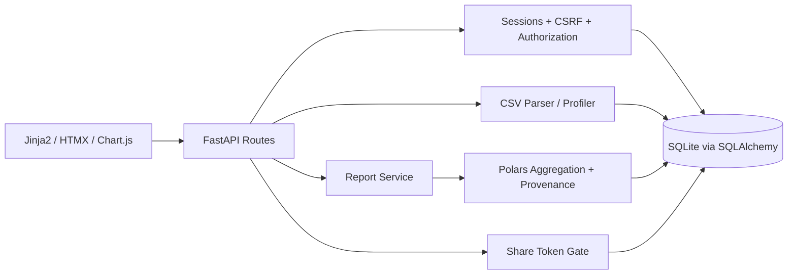

# Prooflytics — Architecture and ADRs

## System boundary
Monolithic server-rendered Python web application. Browser uses Jinja2 pages plus HTMX fragments and Chart.js with server-provided JSON datasets. FastAPI controls all authenticated and public routes. SQLAlchemy persists owners, datasets, rows, reports, blocks and share tokens in SQLite.

## Dependency boundaries
- `web/routes`: HTTP, templates, error translation; **no business math**.
- `services/ingestion.py`: bytes → structural parse result → typed record warnings; persistence orchestrated by service layer.
- `services/types.py`: deterministic inference; separate invalid from missing.
- `services/analytics.py`: validated block spec + saved rows + report filter → `CalculationResult(value, exact_spec, narrative, counts, group_breakdown)`.
- `services/reports.py`: CRUD, ordering, block schema validation, ownership checks.
- `services/shares.py`: token issue/hash/expiry/revocation/public projection.
- `db/models.py`: SQLAlchemy typed models; `db/session.py`: transaction boundaries.
- `schemas/`: Pydantic request/response contracts.
- `templates/`, `static/`: display only, no secret-bearing inputs in static bundles.

## Tables (minimum)
- `users(id, email_unique, password_hash, created_at)`
- `sessions(id_hash, user_id, expires_at, created_at)` if using DB-backed opaque sessions
- `datasets(id, owner_id, name, status, original_filename, row_count, created_at, schema_json, profile_json)`
- `dataset_rows(id, dataset_id, source_row_number, raw_json, typed_json, issues_json, structurally_valid)`
- `reports(id, owner_id, dataset_id, title, filter_json, created_at, updated_at)`
- `report_blocks(id, report_id, kind, position, config_json)`
- `share_links(id, report_id, token_hash_unique, expires_at, revoked_at, created_at)`
Indexes on `datasets.owner_id`, `reports.owner_id`, `dataset_rows.dataset_id`, `report_blocks(report_id, position)`, `share_links.token_hash`.

## Auth and authorization
Opaque random session token hashed in DB; cookie HttpOnly/SameSite=Lax, Secure in HTTPS; rotate at login, expire, log out. For POST/PATCH/DELETE session-authenticated routes, require CSRF token or an equivalent robust same-origin defense. Never trust owner IDs from request body. Query by `(id, owner_id)` where possible; also validate report's dataset belongs to owner and block belongs to report before any mutation. Public paths never invoke owner routes.

## Data ingestion decisions
1. Read bounded bytes; reject > configured max.
2. Strict UTF-8 decode (BOM accepted); clear errors for unknown encodings.
3. Parse headers/records through Python `csv` with strict mode. A structural parser failure can make later boundaries ambiguous: preserve failure position/diagnostic, reject or quarantine upload explicitly, do not pretend all records were recovered.
4. Keep raw cell strings and source row positions; mark ragged records, missing cells, bad dates/numbers; no silent coercion.
5. Infer types by deterministic rule, document threshold and sample influence. Example: classify number/date if >=90% of nonblank cells parse, otherwise category when bounded distinct ratio/count, else text; ambiguous columns remain text. Always log invalid conversions.
6. Generate a profile with total parsed rows, accepted/rejected/warned, per-column blanks and invalid counts; rejected rows remain inspectable.

## Query and provenance invariant
**One call** `evaluate_block(dataset_rows, validated_filter, validated_block)` returns both rendered data and explanation, never two separate calculations. The `exact_spec` is a canonical JSON AST (operation, field, group_by, ordering, filters, null policy, limit); this is truly exact even when implementation uses a Polars expression rather than SQL. Include a human-readable Polars expression description **only if actually used**; never label a fabricated SQL statement 'the executed query'. Serialize zero/non-finite outcomes carefully. Group-by counts and included/excluded accounting must reconcile to total input rows by category.

## Sharing semantics and privacy
MVP uses **live report definition**: viewers see current blocks/filters at time of request. Treat table block as owner-authorized public report content. Public projection exposes block output/explanations only, no raw dataset APIs or file content; note text and cells HTML-escaped. Token = `secrets.token_urlsafe(32)`, store SHA-256 digest, compare by indexed digest lookup; check expiry UTC and revoked state every public fetch. Return 404 for unavailable tokens to avoid token-state disclosure; Cache-Control: no-store. Never put tokens in logs.

## CSV errors and data quality math
Distinguish: parse-failed input (upload rejected with diagnostic), row-shape-invalid, filtered-out, field-missing/invalid, included. Do not double count. COUNT semantics specified by operator: `count_rows` counts eligible filtered records; `count_non_null` counts eligible non-null field values. Assignment's 'count of a column' should default to non-null field values and explain it.

## Security threats and mitigations
IDOR → owner-scoped queries; token guessing → 256-bit token; token leakage → no server logging/referrer policies/no-store; XSS → template autoescaping + textContent for user content; CSRF → token validation; oversized payloads → byte cap; CSV formula injection → never spreadsheet-export values; SQL injection → SQLAlchemy bound params; mass assignment → narrow Pydantic DTOs; cache bleed → private/no-store headers.

## Scale ceiling
100x datasets (~500k rows) will stress SQLite JSON-row reads, Polars materialization and memory per request. Next design: validated streamed CSV ingest, Parquet/columnar storage, background ingestion jobs, dataset revision versioning, cached result keyed by report revision/filter, and optimized analytical database. **Do not implement for the assignment.**

## Architecture decision records
- ADR-001 Python FastAPI over Next.js: maximizes applicant's maintainability/live-coding fluency.
- ADR-002 Jinja2 + HTMX over React: fewer components/toolchains for timebox.
- ADR-003 Polars for analytics, Python csv for audited ingest: fast calculation without suppressing malformed rows.
- ADR-004 SQLite for portable no-service setup: accepted at MVP scale.
- ADR-005 Canonical JSON aggregation AST instead of pretending SQL is executed: faithful exact specification.
- ADR-006 Live shares for simplicity: document exposure trade-off; snapshot could be a future improvement.
